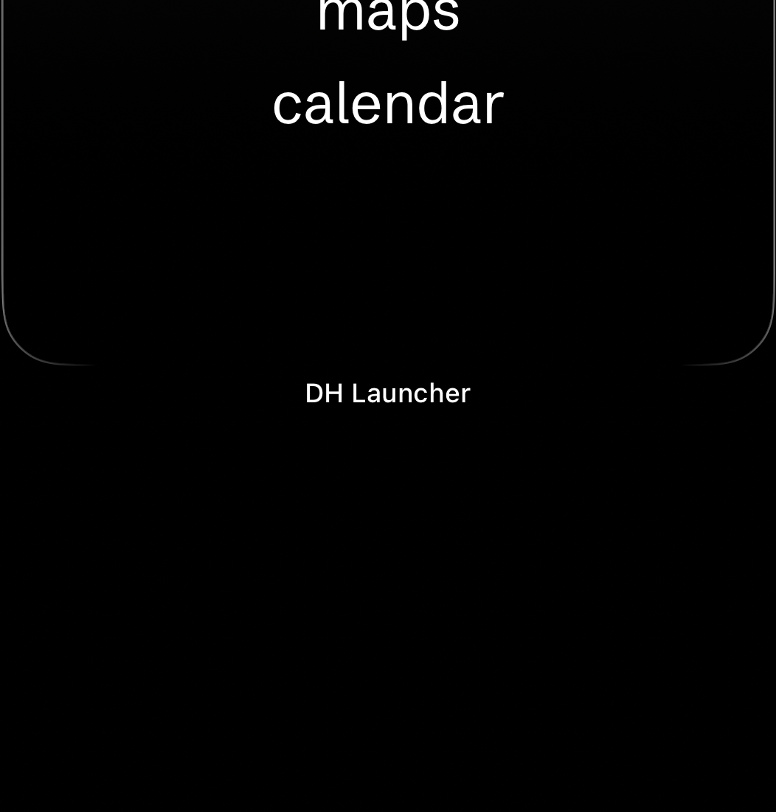
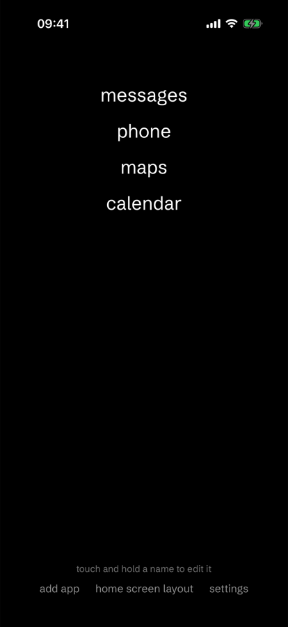
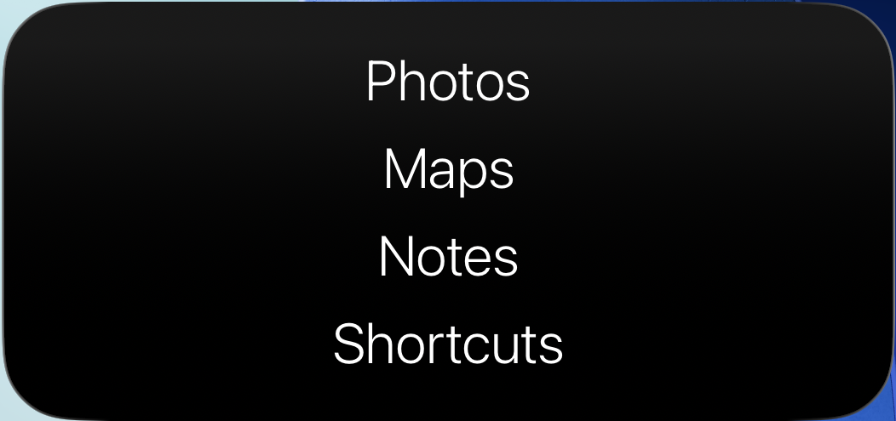

# DH Launcher

*(Working title. The app name, bundle ID and licence are placeholders; see "For the owner" below.)*

A free, open-source, minimal text launcher for iPhone, inspired by
[Olauncher](https://github.com/tanujnotes/olauncher) for Android. It is a fresh
SwiftUI/WidgetKit app; no Olauncher code is used.

<p>
  
  
</p>
<p>
  
</p>

## What it is

- **A home-screen widget** (small, medium, large) showing a plain list of app
  names on black (or white). Tap a name to open that app.
- **Your list is the widget**: open DH Launcher to see, add, edit, remove and
  reorder the widget's apps. Add many at once from a list of common apps, or
  any app with a one-step Shortcut. Apps beyond what the widget can hold are
  marked "doesn't fit".
- **No search of its own**: iOS doesn't tell apps what is installed, so a
  search in DH Launcher could only find apps you added by hand. For everything
  else, use iOS's own Search (on the home screen) and the App Library.
- **Guides** for making the widget your whole home screen and for adding any
  app through a Shortcut.

## What iOS does not allow (and how this works around it)

- **No custom home screen.** iOS has no launcher API. The look comes from a
  black wallpaper, one home-screen page and the large widget on it. The in-app
  setup guide walks through this.
- **No list of installed apps.** You build your own list: from the bundled
  catalog of URL schemes, via a Shortcut, or by typing a URL scheme or link.
- **Widgets cannot open other apps directly.** A widget tap always opens the
  host app, which immediately forwards to the target. You see a short black
  flicker. This bounce is unavoidable for now.
- **Launching by bundle ID is not possible.** Apps open either by URL scheme
  (`spotify://`) or through a Shortcut that contains the "Open App" action,
  run via `shortcuts://run-shortcut?name=…`. The Shortcut route works for any
  app. The first time a Shortcut runs, iOS asks whether it may "output 1 app":
  choose **Always Allow**.
- The app never calls `canOpenURL` and declares no `LSApplicationQueriesSchemes`;
  it just tries to open the link and shows a "Couldn't open…" screen if iOS
  refuses.

## Building

Requirements: Xcode 26 or later (iOS 18 SDK minimum) and
[XcodeGen](https://github.com/yonaskolb/XcodeGen) (`brew install xcodegen`).
There are no other dependencies. The Xcode project is generated and is not
checked in.

```bash
xcodegen generate
```

```bash
xcodebuild -project DHLauncher.xcodeproj -scheme Launcher -destination 'platform=iOS Simulator,name=iPhone 17 Pro' -derivedDataPath build/DerivedData build
```

Change the simulator name to one you have (`xcrun simctl list devices available`).
Simulator builds need no Apple developer team. To run the unit tests, use `test`
instead of `build` in the second command, or run `swift test` inside
`LauncherCore/`.

To install the build on a booted simulator:

```bash
xcrun simctl install booted build/DerivedData/Build/Products/Debug-iphonesimulator/Launcher.app
```

### Running on a device

Set `BUNDLE_PREFIX` and `DEVELOPMENT_TEAM` in `project.yml`, run
`xcodegen generate` again, and build from Xcode. The App Group is derived
from the prefix (`group.<prefix>`) and must be registered for your team.

## Project layout

| Path | What |
|---|---|
| `project.yml` | XcodeGen spec: targets, App Group, URL scheme, placeholders |
| `Launcher/` | The app: your list, add/edit, home-screen list, settings, guides, launch forwarding |
| `LauncherWidget/` | The WidgetKit extension |
| `LauncherCore/` | Swift package with all testable logic: models, JSON store, URL router, widget capacity, catalog |
| `LauncherCore/Sources/LauncherCore/Resources/catalog.json` | Known apps and their URL schemes |

How a widget tap works: the widget row links to `dhlauncher://open?id=<uuid>`;
the app looks the item up in the shared App Group store, shows a plain black
screen and calls `UIApplication.open` on the item's real URL. When you come
back to the app later, it shows your list.

## Contributing catalog entries

`catalog.json` is a list of entries like:

```json
{ "name": "Spotify", "scheme": "spotify://", "verified": false }
```

- Keep the list sorted by name.
- Set `"verified": true` **only** if you have opened the app with that exact
  scheme on a device or simulator. Say in your pull request which iOS version
  you checked on.
- If a scheme is wrong or the app dropped it, fix or remove the entry; users
  can always fall back to the Shortcut route.
- `swift test` (in `LauncherCore/`) checks that every entry is well formed.

Currently verified (on the iOS 26.5 simulator): Calendar, Files, Fitness,
Health, Maps, Messages, News, Photos, Reminders, Safari, Shortcuts, Wallet.
Every third-party scheme, and Apple apps not present on the simulator (App
Store, Books, Music, Notes and others), are unverified.

## App Store

Store text, pictures, the App Preview video, App Review notes and a draft
privacy policy are in `store-listing/`. See `store-listing/SUBMISSION.md` for
what is ready and what the owner still has to do.

## Font

The default font is Schibsted Grotesk, the font of the Digital Habits website
(Settings › Font switches to the iOS system font). It ships in
`LauncherCore/Sources/LauncherCore/Resources/Fonts/` under the SIL Open Font
Licence 1.1 (`SchibstedGrotesk-OFL.txt` next to it), taken unmodified from
[google/fonts](https://github.com/google/fonts/tree/main/ofl/schibstedgrotesk).

## Not yet done

See section 8 of `PLAN.md`: skipping the host-app bounce for universal links,
a single dispatcher Shortcut, lock-screen and Control Center buttons, iPad,
localisation and App Store release.

## For the owner

These are placeholders, not decisions:

1. **App name**: "DH Launcher" (`APP_DISPLAY_NAME` in `project.yml`).
2. **Bundle ID prefix and team**: `org.example.dhlauncher`, no team
   (`BUNDLE_PREFIX`, `DEVELOPMENT_TEAM` in `project.yml`).
3. **Licence**: MIT (see `LICENSE`). GPL-3.0 would match Olauncher, but it
   complicates distributing outside contributions through the App Store.
